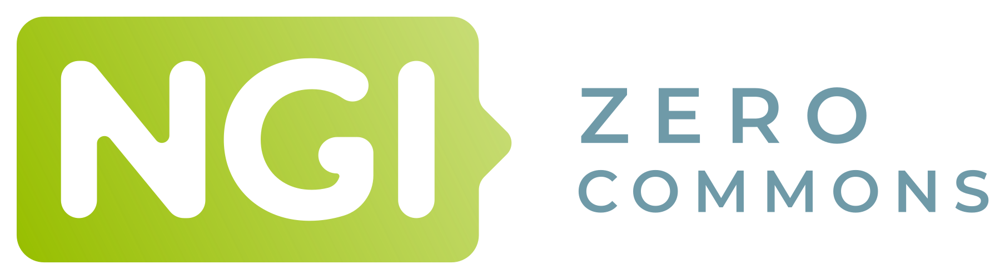
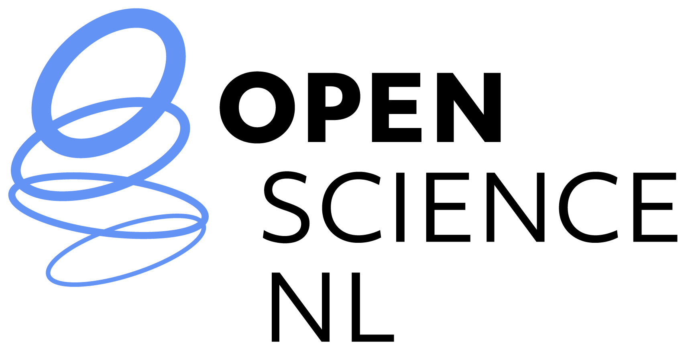

:hide-toc:
:hide-navigation:

.. meta::
   :description: The grants, programs, and sponsors that give financial support to pgmpy.

Supported By
============

NGI0 Commons Fund
^^^^^^^^^^^^^^^^^

:Project: `pgmpy: Open-Source Infrastructure for Causal AI <https://nlnet.nl/project/pgmpy/>`_
:Funder: `NLnet Foundation <https://nlnet.nl/>`_, through the `NGI0 Commons Fund <https://nlnet.nl/commonsfund/>`_
   of the European Commission's Next Generation Internet programme
:Year: 2026

Open Science NL
^^^^^^^^^^^^^^^

:Project: An Open-Source Software Ecosystem for Causal Inference: Addressing Needs Across Research,
   Education, and Industry
:Funder: `Open Science NL <https://www.openscience.nl/en>`_, Open Science Infrastructure call
:Year: 2026
:Project number: 500.040.2467
:Announcement: `45 projects strengthen Dutch open science infrastructure
   <https://www.openscience.nl/en/news/45-projects-strengthen-dutch-open-science-infrastructure>`_

FLOSS/fund
^^^^^^^^^^

:Project: Towards general maintenance of pgmpy.
:Funder: `FLOSS/fund <https://floss.fund/>`_
:Year: 2025

Netherlands eScience Center
^^^^^^^^^^^^^^^^^^^^^^^^^^^

:Project: `Enhancing and Promoting Data Simulation Capabilities of pgmpy
   <https://www.esciencecenter.nl/fellowship-programme/ankur-ankan/>`_
:Funder: `Netherlands eScience Center <https://www.esciencecenter.nl/>`_, through the
   `Fellowship Programme <https://www.esciencecenter.nl/fellowship-programme/>`_
:Year: 2024-2025

Google
^^^^^^

:Funder: Google
:Year: 2014, 2015, 2016, 2026

`Google Summer of Code <https://summerofcode.withgoogle.com/>`_ has paid stipends for students to work on pgmpy.
